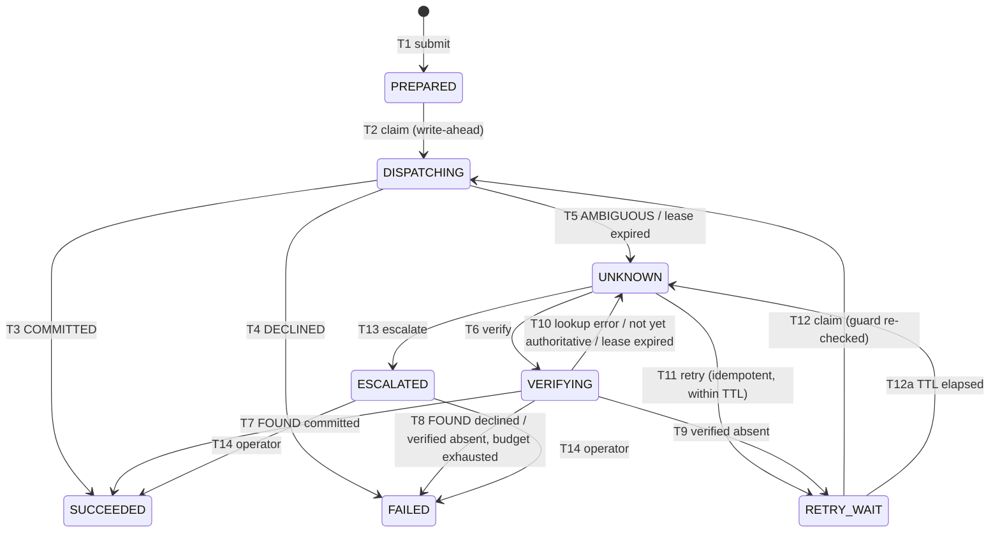

# RAEG Prototype — Design for Review

Status: **DRAFT v0.1, for review. Nothing is implemented yet.**
Paper: *RAEG: A Recovery-Aware Execution Gateway for Fault-Tolerant AI Agents in Financial Microservices* (`ICIYTA_2026_Paper1.pdf`).
This document fixes the architecture, the formal model, the state machine, and the evaluation protocol before any code is written. Decisions that need your sign-off are collected in §11.

---

## 1. Scope and research question

> How can an AI-agent execution framework select safe recovery actions for ambiguous financial transactions under heterogeneous downstream service capabilities?

The prototype must let us measure, for one workload replayed under identical faults, how four execution strategies (naive retry, idempotency-only, Temporal durable execution, RAEG) behave when a payment's outcome is ambiguous.

Out of scope: LLM planning. The "agent" is a deterministic workload driver that emits business intents. That keeps the evaluation about the recovery layer and keeps it reproducible. This is stated as a threat to validity in §10.

---

## 2. Formal model

### 2.1 Action
As in paper Eq. (1): `a_i = (k_i, p_i, s_i)`

| Symbol | Realisation |
|---|---|
| `k_i` | Stable business-action key (string, ≤128 chars). The agent derives it deterministically from its intent (e.g. `UUIDv5(tenant, intent_id)`), so a restarted agent regenerates the same key. RAEG never mints `k_i`. |
| `p_i` | Immutable payload: `{amount_minor:int, currency, payer_id, payee_id, memo}`. No floats. |
| `f_i` | **Payload fingerprint** = `SHA-256(JCS(p_i))`, where JCS is RFC 8785 canonical JSON. Stored with `k_i`. A resubmission of `k_i` with a different `f_i` is rejected (HTTP 409) and never dispatched. |
| `s_i` | Persisted execution state (§3). |

### 2.2 Effects and safety
`E(a_i)` = number of committed payments at the provider whose `client_reference = k_i`, read from the provider's **oracle ledger** (§5.3), which no system under test can read.

- **Safety (S):** `E(a_i) ≤ 1` (paper Eq. 2).
- **Accuracy (A):** if RAEG records `SUCCEEDED` then `E(a_i) = 1`; if it records `FAILED` then `E(a_i) = 0`.
- **Abstention:** `ESCALATED` makes no claim about `E(a_i)`. It is counted as unresolved, never as correct.

### 2.3 Capability profile — proposed extension of Eq. (3)
The paper's `c_i = (I_i, Q_i)` cannot express key expiry or lookup lag, and both are in the requirements. Proposal:

```
c_i = (I_i, τ_i, Q_i, δ_i)
```

| Field | Domain | Meaning |
|---|---|---|
| `I_i` | bool | The provider deduplicates requests carrying the same `Idempotency-Key` and replays the original result. |
| `τ_i` | duration or ∞ | Idempotency key retention, measured from the provider's first receipt of the key. |
| `Q_i` | `none` \| `by_provider_id` \| `by_client_ref` | Outcome lookup mode. Only `by_client_ref` can resolve a lost response, because a lost response also loses the provider id. So `by_provider_id` is treated as `Q = false` for recovery. |
| `δ_i` | duration | **Settle bound.** After `δ_i` has elapsed since the last dispatch, a `NOT_FOUND` lookup is authoritative: no earlier attempt can still commit, and the lookup index reflects every commit. |

The paper text would then define `I_i` as the predicate `I_i(t) ≡ idem ∧ t < t_first + τ_i − m`, where `m` is a safety margin. This change to Eq. (3) needs your approval (§11, Q1).

### 2.4 Observations
Every dispatch or lookup produces one classified observation:

| Observation | Source |
|---|---|
| `COMMITTED(txn)` | 200/201 with `status=succeeded`, or an idempotent replay of one |
| `DECLINED` | 402 / 422 validation. The provider contract guarantees nothing was committed. |
| `AMBIGUOUS` | client timeout, connection reset after send, 5xx, 409 *idempotency-in-progress* |
| `FOUND(committed \| declined, n)` | lookup hit (`n` = number of matching records; `n > 1` means a duplicate already exists) |
| `NOT_FOUND(t_obs)` | lookup miss observed at time `t_obs` |
| `LOOKUP_ERROR` | lookup timeout or 5xx |

A connection refused before any bytes are sent is also classified `AMBIGUOUS` by default (conservative). A `NOT_SENT` fast path is optional (§11, Q6).

### 2.5 Recovery policy R
`R(a_i, c_i) ∈ {verify, retry, escalate}` (paper Eq. 4) is a **pure function**:

```
decide(x: Snapshot, c: Capability, now: Instant, π: Policy) -> Decision
```

It does no I/O, takes `now` as an argument, and is exhaustively unit-tested. `Decision` adds two internal outcomes that the paper's three-way formulation leaves implicit: `WAIT(until)` and `FINALIZE(outcome)`.

```
# Invoked when the state is UNKNOWN
decide(x, c, now, π):
    if c.Q == by_client_ref and x.verify_attempts < π.max_verify:
        return VERIFY
    if c.I and x.dispatch_attempts < π.max_dispatch
           and now < x.first_dispatch_at + c.τ − π.margin:
        return RETRY(basis = IDEMPOTENT_REPLAY)
    return ESCALATE(reason = derive_reason(x, c, now))

# Invoked with the result of a lookup
on_lookup(x, r, c, now, π):
    case FOUND(committed, n): return FINALIZE(SUCCEEDED, duplicate_detected = n > 1)
    case FOUND(declined, _):  return FINALIZE(FAILED)
    case NOT_FOUND(t_obs):
        if t_obs < x.last_dispatch_at + c.δ:
            return WAIT(until = x.last_dispatch_at + c.δ)        # not yet authoritative
        if x.dispatch_attempts < π.max_dispatch:
            return RETRY(basis = VERIFIED_ABSENT)
        return FINALIZE(FAILED, reason = VERIFIED_NOT_EXECUTED)  # E = 0 is proven
    case LOOKUP_ERROR:      return WAIT(until = now + backoff(x.verify_attempts))
```

Properties of R:
- **Verify-first.** When both `I` and `Q` hold, RAEG verifies before retrying. This follows the paper's text ("attempts authoritative reconciliation before deciding whether another invocation is permissible"). Retry-first is kept as an ablation.
- **Capability interaction.** `VERIFIED_ABSENT` permits a retry even when `I = false` or `τ` has expired. Neither baseline can do this.
- **Defence in depth.** When `I = true`, every dispatch carries `Idempotency-Key = k_i`, whatever the basis.
- **Re-checked at dispatch time.** A retry approved with basis `IDEMPOTENT_REPLAY` re-evaluates the TTL guard atomically when it is claimed (T12), because the key can expire between the decision and the dispatch.

### 2.6 Assumptions (the conditions under which S is claimed)
| ID | Assumption |
|---|---|
| A1 | When `I = true`, the provider honours deduplication for at least `τ` from its first receipt. RAEG uses its own `first_dispatch_at` as that time. This is conservative, because the provider receives the request at or after `first_dispatch_at`. |
| A2 | A lookup in mode `by_client_ref` is truthful. `NOT_FOUND` observed at or after `last_dispatch_at + δ` implies that no attempt so far has committed or will commit (in-flight time is bounded). |
| A3 | RAEG's Postgres is durable (fsync on) and the only store of execution state. There is a single primary. |
| A4 | Leases and deadlines use Postgres `now()`, not worker clocks. The provider TTL uses the provider clock. `π.margin` covers skew between the two. |
| A5 | Failures are fail-stop crashes, message loss, and delay. Faults are not Byzantine. |
| A6 | The agent supplies a stable `k_i` (§2.1). |
| A7 | **Zombie bound:** a worker never starts a send once its remaining lease is less than `http_timeout + ε`. A process pause *between* that check and the send is not prevented. The residual risk exists only when `I = false`, and fault F7 measures it rather than assuming it away. |

Faults F4b and F7 (§6.2) deliberately violate A2 and A7, so the paper can report how sensitive S is to its assumptions.

---

## 3. Execution state machine

### 3.1 States
| State | Lease held | Meaning |
|---|---|---|
| `PREPARED` | no | Intent and fingerprint are durable. **Never dispatched**, so dispatching is safe. |
| `DISPATCHING` | yes | Write-ahead: attempt *n* is recorded **before** the HTTP request is sent. The request may or may not have left the process. |
| `UNKNOWN` | no | The outcome is ambiguous and the controller must decide. |
| `VERIFYING` | yes | A lookup is in flight. Lookups have no side effects. |
| `RETRY_WAIT` | no | A retry is approved with a recorded `retry_basis`, and `next_action_at` is set. |
| `SUCCEEDED` | — | Terminal. `E = 1` is established by a response, a lookup, or an idempotent replay. |
| `FAILED` | — | Terminal. `E = 0` is established by a definitive decline or `VERIFIED_NOT_EXECUTED`. |
| `ESCALATED` | — | Terminal for automation. Only an operator can resolve it. |

### 3.2 Transitions
All transitions are compare-and-set (CAS) updates on `(action_key, state, version)`, with fencing on `(lease_owner, attempt_no)` where a lease exists. Each transition appends a row to `execution_events` in the same database transaction.

| # | From → To | Trigger | Guard | Side effects in the same transaction |
|---|---|---|---|---|
| T1 | ∅ → PREPARED | `submit(k,p)` | `k` is new | insert the execution with `f`, payload, and capability snapshot |
| T1a | — | `submit(k,p)` | `k` exists, `f` matches | none; return the current status |
| T1b | — | `submit(k,p)` | `k` exists, `f` differs | none; reject with 409 `FINGERPRINT_CONFLICT` |
| T2 | PREPARED → DISPATCHING | worker claim | CAS wins | `attempt_count++`; set `first_dispatch_at` if null; set `last_dispatch_at`, lease, and an `attempts` row |
| T3 | DISPATCHING → SUCCEEDED | `COMMITTED` | owner and attempt match | store `provider_txn_id` and `outcome_source=response\|replay` |
| T4 | DISPATCHING → FAILED | `DECLINED` | owner and attempt match | `outcome_source=response` |
| T5 | DISPATCHING → UNKNOWN | `AMBIGUOUS`, **or** lease expired (sweeper) | owner matches, or `lease_expires_at < now()` | store `ambiguity_cause` |
| T6 | UNKNOWN → VERIFYING | `decide = VERIFY` | CAS wins | `verify_attempts++` and lease |
| T7 | VERIFYING → SUCCEEDED | `FOUND(committed)` | owner matches | `outcome_source=lookup`; set `duplicate_detected` |
| T8 | VERIFYING → FAILED | `FOUND(declined)`, or `NOT_FOUND` that is authoritative with retries exhausted | owner matches | `outcome_source=lookup` |
| T9 | VERIFYING → RETRY_WAIT | `NOT_FOUND` that is authoritative with retries remaining | owner matches | `retry_basis=VERIFIED_ABSENT` |
| T10 | VERIFYING → UNKNOWN | `LOOKUP_ERROR`, `NOT_FOUND` that is not yet authoritative, or lease expired | owner matches, or lease expired | `next_action_at` |
| T11 | UNKNOWN → RETRY_WAIT | `decide = RETRY(IDEMPOTENT_REPLAY)` | CAS wins | `retry_basis`, `next_action_at` |
| T12 | RETRY_WAIT → DISPATCHING | worker claim | basis is `VERIFIED_ABSENT`, **or** `now() < first_dispatch_at + τ − m` | as in T2 |
| T12a | RETRY_WAIT → UNKNOWN | worker claim | the T12 guard fails (TTL elapsed) | `ambiguity_cause=TTL_EXPIRED_BEFORE_RETRY` |
| T13 | UNKNOWN → ESCALATED | `decide = ESCALATE` | CAS wins | `escalation_reason` |
| T14 | ESCALATED → SUCCEEDED \| FAILED | operator `resolve` | evidence supplied | `outcome_source=operator` |

No other transitions exist. Both `SUCCEEDED` and `FAILED` are absorbing.

Late responses from fenced-out (zombie) attempts are appended to `attempts` as evidence but cannot change state. Whether a `COMMITTED` late response should promote `UNKNOWN` or `ESCALATED` to `SUCCEEDED` is §11, Q7.



### 3.3 Invariants (checked by tests)
- **I1:** No `attempts` row of kind `dispatch` exists unless it was preceded by a T2 or T12 event.
- **I2:** At most one unexpired lease exists per action. This follows from the CAS on a single row.
- **I3:** Each `retry_basis=IDEMPOTENT_REPLAY` dispatch occurred while `now < first_dispatch_at + τ − m`.
- **I4:** Each `retry_basis=VERIFIED_ABSENT` dispatch was preceded by a `NOT_FOUND` with `t_obs ≥ last_dispatch_at + δ`.
- **I5:** Terminal states never change, except `ESCALATED` through T14.
- **I6:** Under A1–A7, `E(a_i) ≤ 1` for every action processed by RAEG. This is validated against the oracle in every integration and fault test.
- **L1 (liveness):** With bounded fault rates and `Q = by_client_ref`, every action reaches a terminal state within `max_dispatch + max_verify` steps. With `Q = none`, it reaches either a terminal state or `ESCALATED`.

---

## 4. Concurrency and crash recovery

| Hazard | Mechanism |
|---|---|
| Two agent submissions of the same `k` race | `INSERT … ON CONFLICT (action_key) DO NOTHING RETURNING`. The loser reads the row and compares fingerprints (T1a or T1b). |
| Two workers claim the same action | `UPDATE … SET state='DISPATCHING' … WHERE action_key=$k AND state IN ('PREPARED','RETRY_WAIT') AND version=$v`. Exactly one claim affects one row. |
| Worker crashes after the write-ahead record, before or after the send | The lease expires, the sweeper applies T5, and the action enters `UNKNOWN`, which is safe whatever the crash point was. |
| Worker crashes after receiving `COMMITTED`, before persisting it | Same path. Recovery then reaches `SUCCEEDED` through lookup or replay. |
| A stale worker records a result after losing its lease | Fencing: the completion `UPDATE` requires `lease_owner=$w AND attempt_count=$n`. |
| The sweeper runs on several replicas | `SELECT … FOR UPDATE SKIP LOCKED LIMIT n`. |
| Lease length | `lease ≥ http_timeout + persist_budget + ε`. A worker aborts before sending if `remaining < http_timeout + ε` (A7). |
| Isolation level | READ COMMITTED. Every transition is a single-row CAS plus inserts, so serializable isolation is unnecessary. This is documented and covered by a concurrency stress test. |

**Named crash points** are used identically by RAEG and by every baseline (§6.2):
`CP1` after the write-ahead commit and before the send; `CP2` after the send and before the response; `CP3` after the response and before it is persisted.
Each is a hook that calls `os._exit(137)` when the fault plan selects it. Docker `restart: unless-stopped` brings the process back up.

---

## 5. Components

### 5.1 Gateway (FastAPI and asyncpg)
- `POST /v1/actions {action_key, payload, provider_profile}` runs T1 and then an inline fast-path dispatch. It returns the terminal outcome, or 202 with the current state.
- `GET /v1/actions/{k}?wait=30s` is a long-poll implemented with Postgres `LISTEN/NOTIFY` on terminal transitions. Using notifications instead of client polling keeps polling granularity out of p95.
- `POST /v1/actions/{k}/resolve` is the operator endpoint for T14. It is unused by the automated experiments.
- The **recovery worker** process runs the sweeper (expired leases), the controller (`UNKNOWN` and due `RETRY_WAIT` rows), and the dispatcher. Two replicas run so that concurrency is real.

### 5.2 Database schema (gateway)
```
executions(action_key PK, fingerprint BYTEA, payload JSONB, profile_id, capability JSONB,
           state, version INT, attempt_count INT, verify_attempts INT,
           first_dispatch_at, last_dispatch_at, next_action_at,
           lease_owner, lease_expires_at, retry_basis, provider_txn_id,
           outcome_source, ambiguity_cause, escalation_reason, duplicate_detected BOOL,
           created_at, updated_at)
attempts(action_key, attempt_no, kind{dispatch,lookup}, worker_id, started_at, finished_at,
         observation, http_status, latency_ms, fenced_out BOOL, error)
execution_events(id BIGSERIAL, action_key, from_state, to_state, transition, decision JSONB,
                 worker_id, db_time)
```
`capability` is a snapshot taken at submission time, so a profile edited during a run cannot change past decisions. Migrations are plain SQL files with no ORM magic.

### 5.3 Synthetic payment provider (FastAPI with its own Postgres)
- `POST /payments` takes an optional `Idempotency-Key` header and a `client_reference` field in the body. The reference is metadata in the style of Stripe's memo field and is always stored.
- `GET /payments/{provider_id}` is enabled when `Q ∈ {by_provider_id, by_client_ref}`. `GET /payments?client_reference=` is enabled when `Q = by_client_ref` and honours the lookup lag. Otherwise it returns 501.
- **Profiles** are YAML: `idempotency` (bool), `key_ttl`, `lookup_mode`, `lookup_lag`, `max_inflight` (together these determine `δ`), `latency` distribution, `decline_rate`, and `concurrent_same_key` (409 or serialize).
- **Oracle:** `GET /oracle/ledger` exports every committed payment. It is reachable only on the harness network, and systems under test have no route to it.
- **Fault injector:** a deterministic per-request plan (§6.2), keyed by `(client_reference, provider_receipt_index)`.

Profiles used in the evaluation:

| ID | I | τ | Q | Meaning |
|---|---|---|---|---|
| P1 | ✓ | long (≫ run) | by_client_ref | Modern provider in the style of Stripe |
| P2 | ✓ | short | by_client_ref | Key expires during recovery |
| P3 | ✓ | long | none | Idempotency without lookup |
| P4 | ✗ | — | by_client_ref | Legacy provider with a reconciliation API |
| P5 | ✗ | — | by_provider_id | Lookup exists but cannot resolve a lost response |
| P6 | ✗ | — | none | Blind legacy provider; RAEG is expected to escalate |
| P7 | ✓ | short | none | TTL expiry without lookup |

### 5.4 Systems under test
All four expose the same driver-facing HTTP contract (`POST /v1/actions`, `GET /v1/actions/{k}?wait`). They share the same provider client: same httpx timeouts, same backoff function, and same crash-point hooks. Only the recovery logic differs.

| System | Persistence | Idempotency key | On ambiguity | On crash |
|---|---|---|---|---|
| **B1 Naive retry** | in memory | none | re-send, up to `max_dispatch` with backoff; then report failure | state is lost; the agent resubmits `k` and a new payment is sent |
| **B2 Idempotency-only** | in memory | `k_i` | re-send with the same key; then report failure | the agent resubmits with the same key |
| **B3 Temporal** | Temporal on Postgres | `k_i` (Temporal's documented best practice) | activity `RetryPolicy` (same `max_dispatch` and backoff); declines are non-retryable | workflow ID = `k_i`, `USE_EXISTING` conflict policy, and the activity is retried after its timeout |
| **RAEG** | Postgres | `k_i` when `I` | `decide()` | sweeper and controller |

Ablations: `RAEG-no-verify` (I-only; this isolates the value of `Q`), `RAEG-no-ttl` (ignores `τ`), and `RAEG-retry-first`. Whether to add a `B3+lookup` variant is §11, Q2.

### 5.5 Agent / workload driver
- A seeded open-loop generator with Poisson arrivals at a configurable rate. It produces `N` intents per run, each with its `k_i`.
- **Agent-restart model,** identical for every system: if the call to the system fails at the transport level (for example, the system crashed), the agent waits for `restart_backoff` and resubmits the **same** `(k_i, p_i)`. This is how an agent with a durable task list but no outcome knowledge behaves.
- **Concurrent duplicates:** a fraction `ρ` of intents are submitted `c` times concurrently.
- The driver writes one JSONL line per action: submit time, terminal time, the system's final claim, and the attempt counts the system reports.

---

## 6. Evaluation protocol

### 6.1 Metrics (computed only from raw files)
| Metric | Definition |
|---|---|
| Duplicate-effect rate | `|{i : E(a_i) ≥ 2}| / N`. Excess effects `Σ max(0, E−1)` are also reported. |
| Recovery completion | Among actions with at least one injected ambiguity: the share that reached `SUCCEEDED` or `FAILED` automatically, with a **correct** claim, within the run horizon |
| Unresolved | Share that is `ESCALATED`, non-terminal at the horizon, or ended with "gave up" (B1, B2, B3) |
| Reconciliation accuracy | Confusion matrix of the system's claim against the oracle (`SUCCEEDED ↔ E≥1`, `FAILED ↔ E=0`). Reported as accuracy over decided actions, with coverage alongside. Two errors are reported separately: **false-failure** (the system claims failure but money moved, the most harmful case) and false-success. |
| Latency | Driver-observed submit → terminal time, with p50, p95, and p99. Reported separately for the fault-free path (overhead) and the recovery path. |
| Duplicate detection (RAEG) | Share of duplicates that RAEG flagged through `duplicate_detected` |

For B1, B2, and B3, a "gave up" outcome is treated as a `FAILED` claim when scoring accuracy, because that is what an agent would act on. It is also counted as unresolved. Both readings are reported.

### 6.2 Fault catalogue
| ID | Fault | Where it is injected |
|---|---|---|
| F0 | None (baseline overhead) | — |
| F1 | Lost response: the provider commits, then aborts the connection | provider |
| F2 | Post-commit gateway crash at `CP3` | system under test (crash hook) |
| F3 | Pre-commit timeout: the provider stalls past the client timeout and never commits | provider |
| F4 | Delayed commit: the provider commits after the client timeout but within `δ` | provider |
| F4b | Delayed commit **beyond** `δ` (violates A2) | provider |
| F5 | Concurrent duplicate submissions (`ρ`, `c`) | driver |
| F6 | Crash at `CP1` or `CP2` | system under test |
| F7 | Zombie: the worker pauses past its lease, then sends (violates A7) | system under test |
| F8 | Lookup unavailable or erroring | provider |
| FM | A mixture of F1–F6 at rate `φ` | all |

**Determinism:** a `fault_plan.json` is generated once per `(seed, workload)` before any system runs. It maps `(k_i, attempt_index)` to a fault. Every system replays the same plan, which is how "equivalent workloads" is enforced. The plan file is saved in the run directory.

### 6.3 Experiment matrix and fairness
- The matrix is {B1, B2, B3, RAEG, ablations} × {P1–P7} × {F0, F1, …, FM} × `R` seeds.
- Systems run **one at a time** on fresh volumes (`docker compose down -v` between runs). The order of systems is randomised within each seed. CPU and memory limits are pinned per container.
- Time is compressed so the matrix fits a workstation: latency is in milliseconds, `τ` and `δ` are in seconds, and every value is listed in the experiment YAML.
- Hypotheses and metric definitions are written to `docs/HYPOTHESES.md` and committed **before** the main runs, so pilot data cannot shape them. The tables and figures report only what the raw data shows.
- Statistics: per-cell mean with 95% bootstrap confidence intervals over seeds, plus raw counts for duplicates, which are rare events.

### 6.4 Reproducibility and provenance
Every run writes an immutable directory, `results/raw/<run_id>/`, containing:
- `manifest.json`: git SHA and dirty flag, resolved config with its hash, seed, image digests, `uv.lock` hash, host CPU, memory, and OS, Docker version, and start and end timestamps
- `fault_plan.json`, `workload.jsonl`, `driver_results.jsonl`
- `oracle_ledger.csv`, plus `executions.csv`, `attempts.csv`, and `events.csv` dumps (RAEG); Temporal workflow histories (B3)
- `logs/`: structured JSON logs from every container (`docker compose logs --timestamps`)

`results/derived/` is produced only by `analysis/` scripts that read `raw/`. Re-running analysis regenerates it bit-for-bit.
Test runs write `results/tests/<timestamp>/` with JUnit XML and full pytest output.
Raw results are never edited by hand. Failed or aborted runs are kept and marked as such in `manifest.json`.

---

## 7. Repository layout
```
.
├── docs/            DESIGN.md · HYPOTHESES.md · ASSUMPTIONS.md · RUNBOOK.md
├── docker-compose.yml            # core: raeg-db, provider, provider-db, harness
├── compose/                      # overlays per system: raeg.yml, naive.yml, idem.yml, temporal.yml
├── pyproject.toml · uv.lock · Makefile
├── src/
│   ├── raeg_common/              # fingerprint (JCS), models, capability schema, provider client, crash hooks
│   ├── raeg_gateway/
│   │   ├── api.py  store.py  sweeper.py  dispatcher.py  worker.py
│   │   ├── controller.py         # pure decide()/on_lookup()
│   │   ├── transitions.py        # the T1–T14 table as data + CAS SQL
│   │   └── migrations/*.sql
│   ├── payment_provider/         # app, ledger, idempotency, lookup, faults, oracle
│   ├── baselines/
│   │   ├── naive/  idempotency_only/
│   │   └── temporal_wf/          # workflow.py, activities.py, worker.py, shim_api.py
│   ├── harness/                  # workload.py, fault_plan.py, driver.py, runner.py, collector.py
│   └── analysis/                 # metrics.py, aggregate.py, figures.py
├── config/
│   ├── profiles/P1..P7.yaml
│   ├── faults/*.yaml
│   └── experiments/*.yaml        # one file per paper table/figure
├── tests/
│   ├── unit/                     # controller decision table (exhaustive), fingerprint, transitions
│   ├── property/                 # Hypothesis model-based test of the state machine against a provider model
│   ├── integration/              # docker-backed: concurrency stress, crash points, oracle checks
│   └── fault/                    # one test per F-id per system; asserts S/A only for RAEG under A1–A7
└── results/  raw/ · derived/ · tests/
```

---

## 8. Technology choices
- Python 3.12, managed with **uv** and a lockfile. The libraries are FastAPI, uvicorn, asyncpg (raw SQL, no ORM, so the CAS statements are explicit and visible in the paper), httpx, pydantic v2, structlog, Hypothesis, and pytest.
- Postgres 16, with one instance for RAEG and a separate one for the provider and oracle, so ground truth is isolated from the systems under test.
- Temporal server backed by Postgres, not the SQLite dev server, for a fair durability comparison. It uses the `temporalio` Python SDK. All images are pinned by digest at implementation time.
- Fault injection lives inside the application, not in Toxiproxy, because per-request deterministic replay across systems is simpler there. Toxiproxy can be added later for network-level faults if reviewers ask for it.

---

## 9. Implementation plan
Each milestone ends with tests passing and their logs saved.

| M | Deliverable | Exit criterion |
|---|---|---|
| M0 | Scaffolding: `git init`, uv, Compose skeleton, Makefile, CI script, run-manifest writer | `make up` starts the databases; `make test` runs an empty suite and saves its log |
| M1 | `raeg_common`: JCS fingerprint, models, capability schema, profile loader | Unit tests, including RFC 8785 test vectors |
| M2 | Payment provider: ledger, idempotency with TTL, lookup modes and lag, oracle, fault injector | Per-profile contract tests; oracle counts match injected commits |
| M3 | Gateway store: schema, transition table, CAS, leases, events | Concurrency stress test (many concurrent submit and claim calls) shows I1, I2, and I5 hold |
| M4 | Controller, dispatcher, sweeper, crash hooks | Exhaustive `decide()` table tests; Hypothesis model-based test; crash-point integration tests show S and A hold |
| M5 | Baselines B1, B2, and B3 behind the shared contract | Each passes F0 smoke tests; same client and hooks verified by test |
| M6 | Harness: workload, fault plan, driver, runner, collector | One end-to-end pilot cell (P1 × F1 × all systems) produces a complete raw directory |
| M7 | Pilot and calibration (timeouts, lease, `N`, `R`); freeze `HYPOTHESES.md` and the experiment configs | Commit tagged `eval-freeze` |
| M8 | Full matrix; analysis; figures and tables generated from raw data | `make analyze` reproduces every number in the paper from `results/raw/` |

Optional: a TLA+ model of §3 checked with TLC for S and L1. It would strengthen the formal claim; see §11, Q8.

---

## 10. Threats to validity (for the paper)
- The provider is synthetic, and its contract (A1, A2) is idealised. F4b and F7 quantify what happens when it is not.
- Time compression may hide effects that depend on real-world timescales.
- The deployment is a single host with a single database primary, so there are no partitions between the gateway and its database.
- The agent is a deterministic driver, not an LLM. Behaviour such as an LLM re-planning a payment with a *new* `k_i` falls outside RAEG's guarantees. This should be discussed, not measured.
- The Temporal baseline reflects one reasonable configuration; better-engineered activities could close part of the gap (§11, Q2).

---

## 11. Decisions needed from you
1. **Eq. (3) extension.** Do you approve `c_i = (I_i, τ_i, Q_i, δ_i)` and the three-valued `Q`? The paper text would change.
2. **Temporal fairness.** Should B3 be plain Temporal with an idempotency key, or should it also include `B3+lookup` (a Temporal activity that performs lookup-before-retry)? I recommend including both. That shows the contribution is the capability-aware policy, not the runtime, and it pre-empts the obvious reviewer objection.
3. **Verify-first or retry-first** when both `I` and `Q` hold. I recommend verify-first as the default (it matches the paper) with retry-first as an ablation.
4. **Scale.** I propose `N = 1000` actions per cell, `R = 10` seeds, and a fault rate `φ ∈ {0.05, 0.2}`, to be confirmed after the M7 pilot.
5. **Escalations.** No operator acts during the experiments, so `ESCALATED` counts as unresolved. Is that acceptable?
6. **`NOT_SENT` fast path** (connection refused counts as safe to retry). I recommend leaving it off for the paper (conservative) and mentioning it in the text.
7. **Late `COMMITTED` evidence** from a fenced-out attempt. Should it automatically finalize `UNKNOWN` or `ESCALATED` as `SUCCEEDED`? I recommend yes for `UNKNOWN` and no for `ESCALATED` (keeping escalation operator-only).
8. **TLA+ spec.** Include it or skip it, given the ICICYTA page limit.
