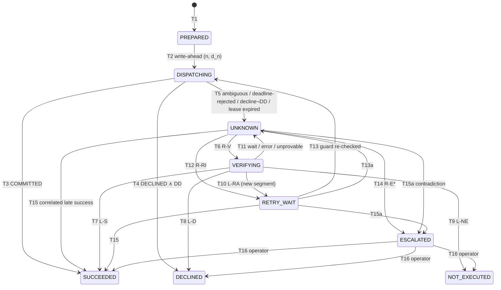

# RAEG Prototype — Design for Review

Status: **DRAFT v0.2, for review. Nothing is implemented yet.**
Paper: *RAEG: A Recovery-Aware Execution Gateway for Fault-Tolerant AI Agents in Financial Microservices* (`ICIYTA_2026_Paper1.pdf`).
Previous version: `docs/archive/DESIGN-v0.1.md`. Decisions still open are listed in §12.

---

## 0. Changes from v0.1

| # | Review item | Change in v0.2 | Where |
|---|---|---|---|
| C1 | Precise idempotency and TTL guarantees, including delayed and overlapping requests | Provider idempotency contract K1–K7. The TTL guard now uses each attempt's **deadline** rather than its send time, so a request that is sent or delivered late cannot outlive the key. The retention window is anchored at the start of the current **segment** (the attempts since the last proof of absence). | §2.4, §2.6 |
| C2 | Zombie-worker dispatch | New capability **D**: the provider enforces a per-request deadline at commit time. The safety claim is split. **Tier S** (strict, the default) is sound under unbounded process pauses and relies on D, or on `τ = ∞` with I. **Tier B** (bounded-pause mode) is reported separately and is conditional on assumption B1. Without D, RAEG-strict never treats a lookup miss as proof of absence. | §2.3, §2.7, §4 |
| C3 | Settlement and lookup consistency for an authoritative NOT_FOUND | Lookup contract L1–L5: soundness, completeness after `δ`, a provider-clock `as_of`, all matches returned, and scoping. NOT_FOUND counts as authoritative only when `as_of ≥ max_deadline + δ` **and** the effect horizon is enforced. | §2.5 |
| C4 | Definitive decline vs verified non-execution | `FAILED` is split into the terminal states **DECLINED** and **NOT_EXECUTED**. A decline is accepted as definitive for the *action* only when every earlier attempt has been ruled out (rule DD). Otherwise it is treated as ambiguous. | §2.8, §3 |
| C5 | Unresolved vs explicit false failure | A common claim taxonomy (`SUCCESS`, `NO_EFFECT(declined \| verified)`, `UNRESOLVED(reason)`) with a native-output→claim mapping for every system. "False failure" counts explicit `NO_EFFECT` claims only. A pessimistic-agent rescoring is reported separately and labelled as such. | §6.1–6.2 |
| C6 | Raw evidence for all recovery decisions | Append-only `evidence`, `decisions` (with a rule ID and the full input snapshot), a hash-chained `execution_events` table, and `anomalies`. The provider keeps a receipt log. The shared client keeps an exchange log for every system. Temporal histories are exported. All tables are enforced append-only by database triggers and grants. | §5.2, §7 |
| C7 | Decision 7: late success | Transition T15 accepts a late success only when it is correlated (C-1…C-4) and recorded in an auditable way. If the late success contradicts an earlier proof of absence, the action is escalated and an anomaly is recorded. ESCALATED actions remain operator-only. | §3.2 |
| C8 | Decision 2 | Added **B3L**, Temporal with lookup-before-retry. | §5.4 |
| C9 | Decision 4 | Pilot protocol, with a pre-stated rule for choosing `N` and `R`. | §8.3 |
| C10 | (new) | Assumption-violation faults V1–V4 measure how the safety property degrades when a declared capability is false. | §6.3 |

**Change to the capability model that needs re-approval:** `(I, τ, Q, δ)` becomes `(I, τ, Q, δ, D)`, and `δ` is narrowed to mean lookup visibility lag. §2.7 argues that no client-side mechanism alone prevents zombie dispatch under unbounded pauses, so either D is added or the claim is weakened. See §12, Q1.

---

## 1. Scope and research question

> How can an AI-agent execution framework select safe recovery actions for ambiguous financial transactions under heterogeneous downstream service capabilities?

The prototype measures how six execution strategies behave when a payment outcome is ambiguous: naive retry, idempotency-only, Temporal, Temporal with lookup, RAEG-strict, and RAEG-bounded. All strategies run the same workload under the same deterministically replayed faults. LLM planning is out of scope; the "agent" is a deterministic workload driver (§10).

---

## 2. Formal model

### 2.1 Action and identity
`a_i = (k_i, p_i, s_i)` (paper Eq. 1).

| Symbol | Realisation |
|---|---|
| `k_i` | Stable business-action key, derived by the agent from its intent (e.g. `UUIDv5(tenant, intent_id)`). RAEG never mints keys. When `I = true`, `k_i` is also sent as the `Idempotency-Key`. It is always sent as `client_reference`. |
| `p_i` | Immutable payload `{amount_minor:int, currency, payer_id, payee_id, memo}`. |
| `f_i` | `SHA-256(JCS(p_i))`, using RFC 8785 canonical JSON. Resubmitting `k_i` with a different `f_i` is rejected with 409 and never dispatched. |
| attempt `j` | Each dispatch has `attempt_no j` and an absolute deadline `d_j`. Both are persisted **before** the send (write-ahead). The send carries the headers `Request-Deadline: d_j` and `X-RAEG-Attempt: j`. |

### 2.2 Effects and claims
- `E(a_i)` is the number of **succeeded** payments at the provider with `client_reference = k_i`. It is read from the oracle ledger (§5.3). Declined records do not count.
- **Safety S:** `E(a_i) ≤ 1` for every action. This includes actions that end ESCALATED.
- **Claim correctness:** `SUCCEEDED ⇒ E ≥ 1`, and `DECLINED ∨ NOT_EXECUTED ⇒ E = 0`. `ESCALATED` makes no claim.

### 2.3 Capability profile `c = (I, τ, Q, δ, D)`

| Field | Domain | Meaning (each is a provider *contract*, specified below) |
|---|---|---|
| `I` | bool | The provider honours idempotency contract K1–K7 (§2.4). |
| `τ` | duration or ∞ | Minimum retention of an idempotency record, measured from its creation on the provider clock. |
| `Q` | `none` \| `by_provider_id` \| `by_client_ref` | Lookup mode. Only `by_client_ref` can resolve a lost response, so it is the only mode treated as lookup-capable. |
| `δ` | duration | Lookup visibility lag. A payment committed at provider time `t` appears in every lookup evaluated at provider time `≥ t + δ` (L2). |
| `D` | bool | **Deadline enforcement.** No request carrying `Request-Deadline: d` becomes committed after provider time `d` (§2.7). |

Deployment and policy parameters (not provider capabilities): `ε` is the bound on skew between the RAEG database clock and the provider clock; `m` is a safety margin; `T_att` is the attempt duration (`d_j = claim_time + T_att`); `max_dispatch` and `max_verify` are the attempt budgets.

### 2.4 Provider idempotency contract (applies when `I = true`)
| ID | Guarantee |
|---|---|
| K1 | **Atomic reservation.** The first accepted request with key `K` creates a record `(K, f, state=IN_PROGRESS, created_at)`. The payment commit and the transition of the record to `COMPLETED(response)` happen in **one** provider transaction. |
| K2 | **Overlap.** A request with key `K` that arrives while `K` is `IN_PROGRESS` has no effect. Depending on the profile, it either gets `409 IDEMPOTENCY_IN_PROGRESS` (`overlap=reject`) or waits for the first request and then receives its replay (`overlap=serialize`). |
| K3 | **Replay.** A request with key `K` arriving while `K` is `COMPLETED` and retained returns the stored response, marked `Idempotent-Replayed: true`, and has no effect. This holds for stored declines as well as stored successes. |
| K4 | **Mismatch.** The same `K` with a different body fingerprint returns `422 IDEMPOTENCY_MISMATCH` with no effect. RAEG treats this as an internal error and escalates. |
| K5 | **Retention.** A `COMPLETED` record is retained for at least `τ` after `created_at`. After that, behaviour is unspecified: the request may be treated as new. |
| K6 | **Pre-commit abort.** If processing aborts before commit, the reservation is removed in the same rollback. Re-execution is then allowed, and at most one commit can ever exist for `K` within retention. |
| K7 | **Crash recovery.** After a provider restart, an `IN_PROGRESS` reservation whose payment transaction did not commit is released. Under K1 this is decidable, because the commit flips the record. |

Delayed and overlapping deliveries are covered as follows.
- **(a) A retry overtakes a delayed original** (the provider sees attempt 2 before attempt 1). Attempt 2 creates the record. Attempt 1 then gets 409 or a replay, provided it arrives within retention of that record.
- **(b) The original arrives after the record has expired.** This is the only TTL hazard, and the guard (§2.6) excludes it by bounding every accepted arrival by its deadline.
- **(c) Overlapping attempts.** Covered by K2. RAEG classifies a 409 as `AMBIGUOUS` and verifies.

### 2.5 Lookup and settlement contract (applies when `Q = by_client_ref`)
| ID | Guarantee |
|---|---|
| L1 | **Soundness.** A lookup returns only committed records: succeeded or declined, never in-flight. |
| L2 | **Completeness after δ.** Every record committed at provider time `t` is returned by every lookup with `as_of ≥ t + δ`. |
| L3 | **Evaluation time.** Every response carries `as_of`, the provider-clock time at which the lookup was evaluated. If a real provider lacks `as_of`, RAEG uses the lookup's send time minus `ε` (a conservative lower bound). |
| L4 | **All matches.** All records for `client_reference` are returned without pagination truncation, which enables duplicate detection. |
| L5 | **Scoping.** `client_reference` is namespaced to RAEG's merchant account, so no other client can create matching records. |

**Effect horizon.** `H(x) = max_j d_j` over all attempts dispatched so far. RAEG persists this value as `max_deadline` before every send.

**Authoritative absence.** A lookup result `r` proves `E = 0` for all attempts so far (and for every future effect of those attempts) iff:
```
r.records has no committed-succeeded entry
∧ r.as_of ≥ H(x) + δ
∧ (D ∨ mode = BOUNDED)
```
Under D, every effect of an attempt so far occurs at provider time `≤ H(x)`, and under L2 it is visible by `H(x) + δ`. Both bounds are on the provider clock, so `ε` does not enter. Without D, the first conjunct relies on assumption B1 (§2.7).

### 2.6 TTL guard for idempotent replay
A **segment** is the run of attempts after the most recent proof of absence (or after submission). `anchor` is the write-ahead time of the segment's first attempt, on the RAEG database clock.

A dispatch of attempt `n` with deadline `d_n` and basis `IDEMPOTENT_REPLAY` is permitted iff
```
I ∧ ( τ = ∞  ∨  ( (D ∨ mode = BOUNDED)  ∧  d_n + ε + m ≤ anchor + τ ) )
```
Argument. Every attempt prior to the segment is proven to have no effect, so any committed record for `k` was created by an attempt in the segment, at provider time `≥ anchor − ε`. Under D, every accepted arrival happens at `≤ d_n`. So if a commit exists, its record is still retained when any later attempt arrives (K5), and that attempt is replayed (K3). The guard is evaluated against the deadline written with the claim, not the actual send time. A late send therefore cannot violate it, because D rejects anything arriving after `d_n`.

### 2.7 Zombie dispatch and the two safety tiers
A **zombie** is a worker that claims attempt `j` and then pauses: through GC, SIGSTOP, VM suspension, or a long scheduling delay. Its lease expires, recovery proceeds, and the worker then wakes up and sends attempt `j`.

**No client-side mechanism is sufficient on its own.** A check before sending cannot be atomic with the send. Fencing tokens only help if the resource (the provider) checks them (Kleppmann, *Designing Data-Intensive Applications*, ch. 8). For a provider without D, a request with no idempotency key can therefore arrive at any time after any lookup. RAEG makes two different claims:

| Tier | Mode | Claim | Requirements |
|---|---|---|---|
| **S** | `STRICT` (default) | `E ≤ 1` under **arbitrary** process pauses and network delay | Every retry basis must be covered by a provider-enforced mechanism: D (deadline), or `I ∧ τ = ∞`. Without D, a lookup miss is **never** authoritative, and replay is allowed only with `τ = ∞`. Otherwise RAEG escalates. |
| **B** | `BOUNDED` (variant) | `E ≤ 1` **if** B1 holds | **B1:** for every attempt, (database-time claim → provider arrival) `≤ d_j − claim_time`. In words: no process pause plus network delay exceeds the attempt's deadline slack. RAEG checks this locally before sending, but cannot guarantee it. |

How D works as the fence. The deadline is chosen and **persisted before the send**, and the provider enforces it at **commit** time. Every attempt therefore has a known, durable effect horizon, however long its worker pauses. The synthetic provider implements D with a `DEFERRED` constraint trigger that checks `clock_timestamp() ≤ deadline` inside the commit transaction. Real-world analogues mostly check at receipt only; for example, AWS SigV4 enforces a request-time validity window. A provider that checks only at receipt can be modelled as D with horizon `d + Π`, but only under an extra bound `Π` on provider processing time. This is noted as a threat to validity rather than claimed.

The paper's headline safety results are Tier S. Tier B appears in a separate table next to fault F7.

### 2.8 Definitive outcomes per action
Observations are per **attempt**. Claims are per **action**. They must not be conflated.

**Rule DD (definitive decline).** A `DECLINED` response or lookup record for attempt `n` establishes `E = 0` for the action iff every other attempt is ruled out. That is the case when one of these holds:
- `n = 1` and no other attempt exists.
- All attempts before `n` are covered by a proof of absence, and `n` is the only attempt in its segment.
- `I` holds and the replay guard (§2.6) held for every attempt in the segment, so the key admits only one processing.
- An authoritative lookup (§2.5) shows no succeeded record.

Otherwise the decline is recorded as evidence and the action goes to `UNKNOWN`. Example: in a provider without idempotency, attempt 2 can be declined for insufficient funds *because* attempt 1 committed.

**Rule DS (success with possible duplicate).** `COMMITTED` on any attempt establishes `E ≥ 1`, so the action becomes SUCCEEDED. If earlier attempts in the segment are not covered by I, a **duplicate audit** is scheduled at `H + δ` when `Q` is available. The audit records the effect count as evidence. It never changes state, but it raises `duplicate_detected`.

### 2.9 Observation classes
| Observation | Source | Per-attempt meaning |
|---|---|---|
| `COMMITTED(txn)` | 200/201 `succeeded`, or a replay of one | the attempt (or its key) took effect |
| `DECLINED` | 402 business decline / 422 validation, or a replay of one | this attempt (or its key) did not take effect; action-level status needs DD |
| `DEADLINE_REJECTED` | 409 `DEADLINE_EXCEEDED` (only with D) | this attempt has no effect |
| `AMBIGUOUS` | client timeout, reset after send, 5xx, 409 `IDEMPOTENCY_IN_PROGRESS`, connection refused (NOT_SENT stays disabled) | unknown |
| `LOOKUP(records, as_of)` | lookup response | evaluated against §2.5 |
| `LOOKUP_ERROR` | lookup timeout or 5xx | no information |

### 2.10 Recovery policy `R`
These are pure functions with no I/O. `now` is an argument. Every return value carries a **rule ID**, which is persisted in `decisions`.

```
decide(x, c, now, π):                              # x.state == UNKNOWN
  if x.pending_late_success:          return late_success(x)           # §3.2 T15 / T15a
  if c.Q == by_client_ref and x.verify_attempts < π.max_verify:
                                      return VERIFY                     # R-V
  if x.attempts < π.max_dispatch and replay_ok(x, c, now + π.T_att, π):
                                      return RETRY(IDEMPOTENT_REPLAY)   # R-RI
  return ESCALATE(reason(x, c, π))                                      # R-E*

on_lookup(x, r, c, π):
  S = succeeded records in r;  Dc = declined records in r
  if |S| ≥ 1:                         return FINALIZE(SUCCEEDED, dup=|S|>1)          # L-S
  if not absence_authoritative(x, r, c, π):
      if c.D or π.mode == BOUNDED:    return WAIT(until = x.max_deadline + c.δ)     # L-W
      if |Dc| ≥ 1 and DD(x, r):       return FINALIZE(DECLINED)                     # L-D1
      return ESCALATE(ABSENCE_UNPROVABLE)                                           # L-EU
  if |Dc| ≥ 1:                        return FINALIZE(DECLINED)                     # L-D2
  x.absence_proven_through := x.max_deadline
  if x.attempts < π.max_dispatch:     return RETRY(VERIFIED_ABSENT)                 # L-RA
  return FINALIZE(NOT_EXECUTED)                                                     # L-NE
  # LOOKUP_ERROR → WAIT(backoff(verify_attempts)), consuming verify budget          # L-ERR
```

Escalation reasons (R-E*): `NO_SAFE_BASIS` (no lookup and the replay guard fails), `VERIFY_BUDGET_EXHAUSTED`, `DISPATCH_BUDGET_EXHAUSTED`, `ABSENCE_UNPROVABLE`, `CONTRADICTORY_EVIDENCE`, and `INTERNAL` (e.g. a K4 mismatch).

Properties:
- **Verify-first** is the default; retry-first is an ablation.
- **Defence in depth:** when `I` holds, every dispatch carries `k`.
- **Re-checked guards:** every retry guard is re-evaluated atomically at claim time against the actual `d_n` (T13).

---

## 3. Execution state machine

### 3.1 States
| State | Lease | Meaning |
|---|---|---|
| `PREPARED` | – | The intent is durable and has never been dispatched. |
| `DISPATCHING` | until `d_n` | Write-ahead. Attempt `n` and `d_n` are recorded before the send. The lease expiry equals `d_n`. |
| `UNKNOWN` | – | The action-level outcome is not established. |
| `VERIFYING` | yes | A lookup is in flight. |
| `RETRY_WAIT` | – | A retry is approved, with `retry_basis` recorded. |
| `SUCCEEDED` | – | Terminal; `E ≥ 1` is established. |
| `DECLINED` | – | Terminal; the provider refused the action, and `E = 0` is established via DD. |
| `NOT_EXECUTED` | – | Terminal; authoritative absence shows `E = 0` and the dispatch budget is exhausted. |
| `ESCALATED` | – | Automation is suspended. Only an operator can resolve the action. Counted as unresolved. |

`DECLINED` and `NOT_EXECUTED` are distinct because they mean different things to the agent. `DECLINED` is a business refusal: retrying the same intent is pointless. `NOT_EXECUTED` means "nothing happened": the agent may legitimately re-plan.

### 3.2 Transitions
Every transition is a single-row compare-and-set on `(action_key, state, version)`, with fencing on `(lease_owner, attempt_no)` wherever a lease is held. Every transition writes, in the same database transaction:
- a `decisions` row with the rule ID, the input snapshot, and the evidence IDs;
- a hash-chained `execution_events` row.

| # | From → To | Trigger / rule | Guard |
|---|---|---|---|
| T1 | ∅ → PREPARED | submit | `k` is new |
| T1a / T1b | – | submit | `k` exists: if `f` matches, return status; if not, reject with 409 |
| T2 | PREPARED → DISPATCHING | claim | CAS. Sets `n=1`, `d_1 = now()+T_att`, `anchor = now()`, `max_deadline = d_1`, `lease = d_1`. |
| T3 | DISPATCHING → SUCCEEDED | `COMMITTED` (DS) | owner and attempt match |
| T4 | DISPATCHING → DECLINED | `DECLINED` ∧ DD | owner and attempt match |
| T5 | DISPATCHING → UNKNOWN | `AMBIGUOUS`, `DEADLINE_REJECTED`, a decline without DD, or a sweeper finding `now() > d_n` | owner matches, or the lease has expired |
| T6 | UNKNOWN → VERIFYING | R-V | CAS. `verify_attempts++`. |
| T7 | VERIFYING → SUCCEEDED | L-S | owner matches |
| T8 | VERIFYING → DECLINED | L-D1 / L-D2 | owner matches |
| T9 | VERIFYING → NOT_EXECUTED | L-NE | owner matches |
| T10 | VERIFYING → RETRY_WAIT | L-RA | owner matches. Sets `absence_proven_through`; the next attempt starts a new segment. |
| T11 | VERIFYING → UNKNOWN | L-W, L-ERR, L-EU (flags `escalate_next`), or lease expiry | owner matches, or the lease has expired |
| T12 | UNKNOWN → RETRY_WAIT | R-RI | CAS |
| T13 | RETRY_WAIT → DISPATCHING | claim | The basis is re-checked against the new `d_n`: `VERIFIED_ABSENT` (still valid, since nothing was dispatched after the proof), or `replay_ok`. Sets `n++`, `d_n`, `max_deadline`, and `anchor` if a new segment begins. |
| T13a | RETRY_WAIT → UNKNOWN | claim | the guard fails |
| T14 | UNKNOWN → ESCALATED | R-E* | CAS |
| T15 | UNKNOWN \| RETRY_WAIT → SUCCEEDED | late-success rule LS-OK | correlation C-1…C-4 hold ∧ the evidence attempt's `d_j > absence_proven_through` |
| T15a | UNKNOWN \| RETRY_WAIT → ESCALATED | LS-CONTRA | correlated success for an attempt with `d_j ≤ absence_proven_through`, which contradicts an earlier proof of absence. Also writes an `anomalies` row. |
| T16 | ESCALATED → SUCCEEDED \| DECLINED \| NOT_EXECUTED | operator | an evidence ID and operator identity are required |

No other transitions exist. SUCCEEDED, DECLINED, and NOT_EXECUTED are absorbing.

Late evidence that arrives for an action already in one of those states is stored and, if it contradicts the claim, written to `anomalies`. The state does not change. Late evidence for an ESCALATED action is attached to it for the operator only (decision 7).

**Late-success correlation (C-1…C-4).** All four must hold:
- **C-1:** The evidence references an `attempts` row that RAEG created for this `k`, matched by `X-RAEG-Attempt` and `client_reference`.
- **C-2:** The provider's response echoes `client_reference = k`, and its echoed payload fields re-fingerprint to `f`.
- **C-3:** The status is `succeeded` and a `provider_txn_id` is present.
- **C-4:** The evidence row was committed (by the zombie or late worker, which may only *insert* evidence) before the controller applies T15. The decision row cites the evidence ID.

The worker that received the late response never changes state itself. The controller does, through CAS.



### 3.3 Invariants (checked by tests and by a post-run audit of every experiment)
| ID | Invariant |
|---|---|
| I1 | Every request in the provider receipt log that carries `X-RAEG-Attempt` matches an `attempts` row whose commit time precedes the provider arrival time minus `ε` (write-ahead). |
| I2 | At most one unexpired lease exists per action. |
| I3 | Every `IDEMPOTENT_REPLAY` dispatch satisfied the guard in §2.6 at its recorded `d_n`. |
| I4 | Every `VERIFIED_ABSENT` dispatch is preceded by lookup evidence with `as_of ≥ previous max_deadline + δ`, and either `D` holds or the mode is `BOUNDED`. |
| I5 | Terminal states are absorbing; ESCALATED changes only through T16. |
| I6 | Every state change has exactly one `decisions` row, and every evidence ID it cites exists. The event hash chain verifies. |
| I7 | Every DECLINED or NOT_EXECUTED claim satisfies DD or authoritative absence, as reconstructed from the cited evidence alone. |
| I8 | `executions` (the only mutable table) can be rebuilt exactly from `execution_events`. |
| S | `E(a_i) ≤ 1` (oracle) for every action under Tier S assumptions (§11). |
| L | With bounded fault rates and `Q = by_client_ref`, every action reaches a terminal state or ESCALATED within `max_dispatch + max_verify` steps plus bounded waits. |

**Proof sketch of S (Tier S, for the paper).** The proof is by induction over segments.
1. Each new segment starts only after authoritative absence (§2.5). With D, every earlier attempt can never take effect.
2. Within a segment, attempts after the first are dispatched only with `IDEMPOTENT_REPLAY`. They share key `k`, and every accepted arrival happens before retention of any committed record for `k` ends (§2.6). By K1–K3 and K6, the segment therefore commits at most once.
3. Combining 1 and 2, at most one segment commits, so `E ≤ 1`.

---

## 4. Concurrency, crash recovery, zombies

| Hazard | Mechanism |
|---|---|
| Concurrent submissions with the same `k` | `INSERT … ON CONFLICT DO NOTHING RETURNING`, then T1a/T1b |
| Concurrent claims | Single-row CAS on `state` and `version`; the update affects exactly one row |
| Crash at CP1 (after write-ahead, before send), CP2 (after send, before response), or CP3 (after response, before persist) | The lease, which equals `d_n`, expires. T5 moves the action to UNKNOWN. Verification at `≥ d_n + δ`, or idempotent replay, resolves it. |
| A stale worker writes a result | Completion is fenced by `lease_owner` and `attempt_no`. Stale workers may only insert `evidence` rows (late-success path). |
| A zombie sends after its lease expired | **Tier S:** if D, the provider rejects any arrival after `d_j`. If `I ∧ τ = ∞`, a replay neutralises it. Otherwise no retry basis is available and the action escalates. **Tier B:** B1 is assumed; fault F7 measures violations. |
| Multiple sweeper replicas | `FOR UPDATE SKIP LOCKED` |
| Isolation level | READ COMMITTED is sufficient (single-row CAS plus inserts). A stress test verifies I2. |
| Wasted sends | Before sending, the worker skips the send if the remaining deadline budget (database time at claim plus monotonic elapsed time) is below `min_send_budget`. The attempt then resolves through T5 and verification, because NOT_SENT stays disabled. This is an efficiency measure, not a safety mechanism. |

The crash and pause points CP1–CP3 and PAUSE (between claim and send) are hooks in the **shared provider client**. Every system therefore triggers them at identical points, as defined by the fault plan.

---

## 5. Components

### 5.1 Gateway (FastAPI and asyncpg)
| Interface | Purpose |
|---|---|
| `POST /v1/actions` | T1, followed by an inline fast-path dispatch |
| `GET /v1/actions/{k}?wait=` | Long-poll via `LISTEN/NOTIFY` |
| `POST /v1/actions/{k}/resolve` | T16 (operator; not used in experiments) |
| `GET /v1/actions/{k}/evidence` | Full decision and evidence trail |
| recovery worker (×2) | Sweeper, controller, dispatcher, duplicate audits |

### 5.2 Gateway schema
```
executions        (mutable projection) action_key PK, fingerprint, payload, profile_id, capability JSONB,
                  policy JSONB, state, version, attempts, verify_attempts, anchor, max_deadline,
                  absence_proven_through, lease_owner, lease_expires_at, retry_basis, provider_txn_id,
                  outcome_source, escalation_reason, duplicate_detected, pending_late_success, ...
attempts          (append-only) action_key, attempt_no, deadline, segment_no, basis, worker_id, claimed_at_db
evidence          (append-only) id, action_key, attempt_no?, kind{dispatch_response, transport_error,
                  lookup_response, late_response, duplicate_audit, operator_note}, sent_at_db,
                  received_at_db, provider_as_of?, http_status, request_headers, response_headers,
                  raw_body BYTEA, classification, worker_id, fenced BOOL, sha256
decisions         (append-only) id, action_key, at_db, rule_id, policy_version, code_sha,
                  inputs JSONB (snapshot + capability + now + π), evidence_ids[], output JSONB
execution_events  (append-only) id, action_key, from_state, to_state, transition, decision_id,
                  worker_id, at_db, prev_hash, hash
anomalies         (append-only) id, action_key, kind, evidence_ids[], at_db
```
Append-only tables reject UPDATE and DELETE through triggers, and the application role has no UPDATE or DELETE grant on them. The `capability` and `policy` values are snapshotted at submission.

### 5.3 Synthetic payment provider (FastAPI with its own Postgres)
| Interface or component | Behaviour |
|---|---|
| `POST /payments` | Implements K1–K7 when `I`. Enforces `Request-Deadline` at commit when `D`. Always stores `client_reference`. |
| `GET /payments?client_reference=` | Implements L1–L5 when `Q = by_client_ref`, with configurable actual lag `≤ δ`. `GET /payments/{id}` is available when `Q ≠ none`. Unsupported modes return 501. |
| Receipt log (append-only) | Every request received: provider arrival time, all headers (key, deadline, `X-RAEG-Attempt`, `X-System`), body hash, disposition (`accepted`, `replayed`, `in_progress_409`, `mismatch`, `deadline_rejected`, `declined`, `committed`, `fault:<id>`), and the commit ID |
| Oracle (`/oracle/ledger`, `/oracle/receipts`, `/oracle/faults`) | Harness network only. The fault log records **applied** faults alongside the planned ones. |
| Profiles | YAML files containing the capability fields plus `overlap`, the latency distribution, `decline_rate`, `actual_lookup_lag`, and assumption-violation switches (§6.3) |

Profiles:

| ID | I | τ | Q | δ | D | Purpose |
|---|---|---|---|---|---|---|
| P1 | ✓ | ∞ | ref | δ₀ | ✓ | full capabilities |
| P2 | ✓ | short | ref | δ₀ | ✓ | key expires during recovery |
| P3 | ✓ | ∞ | none | – | ✗ | idempotency only, keys never expire |
| P4 | ✗ | – | ref | δ₀ | ✓ | legacy provider with reconciliation and deadlines |
| P4n | ✗ | – | ref | δ₀ | ✗ | same, without deadlines: separates Tier S from Tier B |
| P5 | ✗ | – | by_provider_id | – | ✗ | a lookup that cannot resolve a lost response |
| P6 | ✗ | – | none | – | ✗ | blind provider |
| P7 | ✓ | short | none | – | ✓ | TTL expiry without lookup |

Here `∞` means a value much longer than the run.

### 5.4 Systems under test
All systems share the HTTP contract, the provider client, timeouts, the backoff function, `T_att` (deadline headers are sent by **every** system, so transport conditions are identical), crash and pause hooks, and the exchange log.

| ID | Persistence | Key | Behaviour after an ambiguous outcome | Native terminal outputs |
|---|---|---|---|---|
| B1 Naive | memory | – | re-send up to `max_dispatch` | `ok` / `declined` / `error(class)` |
| B2 Idempotency-only | memory | `k` | re-send with the same key | same as B1 |
| B3 Temporal | Temporal on Postgres | `k` | activity `RetryPolicy`; declines non-retryable; workflow ID = `k` with `USE_EXISTING` | workflow completed / failed(cause) |
| B3L Temporal + lookup | Temporal on Postgres | `k` | After an ambiguous activity failure: wait `δ` (documented), look up by `client_reference`, return success if found, otherwise retry the dispatch activity. No deadline or TTL reasoning, no DD rule, no escalation. | completed / failed(`not_found_after_retries` \| cause) |
| RAEG-strict | Postgres | `k` when `I` | §2.10, Tier S | SUCCEEDED / DECLINED / NOT_EXECUTED / ESCALATED |
| RAEG-bounded | Postgres | `k` when `I` | §2.10, `mode = BOUNDED` | same as RAEG-strict |

Ablations of RAEG-strict:
- `no-verify`: never use lookup.
- `no-ttl`: ignore `τ`.
- `retry-first`: retry before verifying.
- `no-horizon`: treat any NOT_FOUND as authoritative immediately. This isolates the value of the δ and D reasoning.

B3L is intended as a competent but conventional lookup-before-retry implementation. A Temporal implementation of the full RAEG policy would be equivalent by construction. The paper should say this explicitly: the contribution is the policy, not the runtime.

### 5.5 Agent / workload driver
- Seeded, open-loop Poisson arrivals.
- **Restart model** (identical for every system): on a transport failure, or no answer within `agent_timeout`, the agent resubmits the same `(k, p)` after `restart_backoff`, up to `max_resubmits`.
- Concurrent duplicates: a fraction `ρ` of intents is submitted `c` times concurrently.
- Writes `driver_exchanges.jsonl` (every raw request and response with each system) and `claims.jsonl` (the normalized claim per action, with a pointer to the raw line it came from).

---

## 6. Evaluation

### 6.1 Claim taxonomy and mapping
| Normalized claim | RAEG | B1 / B2 | B3 | B3L |
|---|---|---|---|---|
| `SUCCESS` | SUCCEEDED | `ok` | completed | completed |
| `NO_EFFECT(declined)` | DECLINED | `declined` (last response 402/422) | failed, non-retryable decline | same as B3 |
| `NO_EFFECT(verified)` | NOT_EXECUTED | – | – | failed `not_found_after_retries` |
| `UNRESOLVED(escalated)` | ESCALATED | – | – | – |
| `UNRESOLVED(gave_up_ambiguous)` | – | `error(timeout \| reset \| 5xx \| 409)` after retry exhaustion | failed, retries exhausted on a timeout or 5xx cause | same as B3 |
| `UNRESOLVED(horizon)` | no terminal state by the run horizon | same | same | same |

The mapping is a versioned table in `analysis/claims.py`. The native output is kept next to every normalized claim so that a reviewer can re-score.

### 6.2 Metrics
| Metric | Definition (`N` = actions; the oracle gives `E`) |
|---|---|
| Duplicate-effect rate | `|{E ≥ 2}| / N`, plus excess effects `Σ max(0, E−1)`. Each duplicate gets a root-cause label derived from the receipt log. |
| Recovery completion | Among actions with at least one injected ambiguity: the share with a **correct** `SUCCESS` or `NO_EFFECT` claim by the horizon |
| Unresolved | Share of `UNRESOLVED(*)`, broken down by reason. Never counted as a failure claim. |
| False failure | `NO_EFFECT(*) ∧ E ≥ 1`, explicit claims only, broken down into declined and verified |
| False success | `SUCCESS ∧ E = 0` |
| Reconciliation accuracy | Correct claims / decided claims, reported with coverage = decided / N. Full confusion matrix. |
| Latency | Driver-observed submit → terminal time: p50, p95, p99, reported separately for F0 (overhead) and faulted actions (recovery) |
| Detection | Share of duplicates flagged by RAEG's `duplicate_detected` |
| Anomalies | Count of `anomalies` rows (expected 0 outside V-faults) |

**Secondary, labelled "pessimistic-agent rescoring":** `UNRESOLVED(gave_up_ambiguous)` is treated as `NO_EFFECT`. This models agents that read errors as failures. It is reported in a separate table and never merged with the primary metrics.

### 6.3 Faults
Faults are deterministic. `fault_plan.json` is generated per `(seed, workload)` and keyed by `(k, attempt_no)`, or by provider receipt index for faults injected at the provider. It is replayed identically for every system.

| ID | Fault | Injected at |
|---|---|---|
| F0 | none | – |
| F1 | Lost response: the provider commits, then resets the connection | provider |
| F2 | Crash at CP3 | shared client hook |
| F3 | Pre-commit stall past the client timeout; never commits | provider |
| F4 | Delayed commit: after the client timeout, before `d_j` | provider |
| F5 | Concurrent duplicate submissions | driver |
| F6 | Crash at CP1 or CP2 | hook |
| F7 | Zombie: PAUSE between claim and send for longer than `T_att` | hook |
| F8 | Lookup unavailable or erroring | provider |
| F9 | Overtaking: hold the original before provider receipt (delay < `d_j` − send) so that the retry arrives first | provider ingress |
| FM | Mixture of F1–F6 and F9 at rate `φ` | all |
| **V1** | Actual lookup lag > declared `δ` (violates L2) | provider |
| **V2** | Declares D but does not enforce it (violates D) | provider |
| **V3** | Retention < declared `τ` (violates K5) | provider |
| **V4** | Provider clock offset > `ε` | provider |

V-faults deliberately violate declared capabilities. They are reported in a separate "assumption sensitivity" table and are never mixed into the headline results.

---

## 7. Evidence and provenance

Every run produces an immutable directory, `results/raw/<run_id>/`:

| File | Content |
|---|---|
| `manifest.json` | git SHA and dirty flag, resolved config and its hash, seed, image digests, `uv.lock` hash, host specs, Docker version, timestamps, run status (`complete` \| `aborted:<reason>`) |
| `fault_plan.json`, `fault_log.csv` | planned faults and applied faults |
| `workload.jsonl`, `driver_exchanges.jsonl`, `claims.jsonl` | agent side |
| `client_exchanges.jsonl` | every provider call made by every system: request, response bytes, timing, error class, hook fired |
| `provider_receipts.csv`, `oracle_ledger.csv` | ground truth |
| `raeg/{executions,attempts,evidence,decisions,execution_events,anomalies}.csv` | full RAEG trail |
| `temporal/histories/*.json` | B3 and B3L workflow histories |
| `logs/*.jsonl` | structured container logs with timestamps |
| `audit.json` | results of the post-run invariant audit (I1–I8 and S) |

Rules:
1. `results/derived/` is produced only by `analysis/`, reading only `raw/`. It is deterministic and re-runnable.
2. Every reported number can be traced to per-action rows in `derived/actions.parquet`, which joins oracle `E`, claim, native output, and evidence IDs.
3. Raw data is never edited. Failed, aborted, and pilot runs are kept and labelled.
4. Test runs go to `results/tests/<timestamp>/`, with JUnit XML and full pytest output.

---

## 8. Experiment protocol

### 8.1 Matrix
{B1, B2, B3, B3L, RAEG-strict, RAEG-bounded, 4 ablations} × {P1–P7, P4n} × {F0–F9, FM} × `R` seeds. V1–V4 run on P1, P2, and P4 with RAEG-strict, RAEG-bounded, and B3L only.
Not every cell is meaningful; for example, F7 against B1 only exercises the agent restart path. The cell list is fixed in `config/experiments/*.yaml` before the main runs.

### 8.2 Fairness
- Systems run one at a time, on fresh volumes, in an order randomised per seed.
- CPU and memory limits are pinned.
- Every system uses the same client, `T_att`, backoff, and budgets.
- Time is compressed, and every value is recorded in the config.

### 8.3 Pilot (decision 4)
- The pilot covers cells {P1, P2, P4, P6} × {F0, F1, FM} × all systems, with `N = 200` and `R = 3`.
- Its purpose is to calibrate timeouts, `T_att`, and `δ₀`, and to measure the wall-clock cost per cell.
- Pilot data goes to `results/raw/pilot-*` and is **excluded from paper tables**. It may be mentioned as "pilot".
- **Rule for choosing `N` and `R`**, fixed now: choose the smallest `R ≥ 5` and an `N` such that
  1. every faulted cell yields at least 100 faulted actions per seed, and
  2. the projected 95% bootstrap CI half-width of recovery completion is at most 3 percentage points,

  subject to a total wall-clock budget that you set. If the budget is binding, `N = 1000` and `R = 10` are upper bounds.
- The chosen values, the hypotheses, and the metric code are frozen in a commit tagged `eval-freeze` before the main runs.

---

## 9. Repository layout
```
.
├── docs/            DESIGN.md · HYPOTHESES.md · ASSUMPTIONS.md · RUNBOOK.md · archive/
├── docker-compose.yml  compose/{raeg,naive,idem,temporal}.yml
├── pyproject.toml · uv.lock · Makefile
├── src/
│   ├── raeg_common/      fingerprint (JCS), models, capability schema, provider client (+hooks, exchange log)
│   ├── raeg_gateway/     api, store, transitions (T-table as data), controller (pure), dispatcher,
│   │                     sweeper, evidence, audit, migrations/*.sql
│   ├── payment_provider/ app, ledger, idempotency (K1–K7), lookup (L1–L5), deadline (D), faults, oracle
│   ├── baselines/        naive/, idempotency_only/, temporal_wf/ (plain + lookup variants)
│   ├── harness/          workload, fault_plan, driver, runner, collector
│   └── analysis/         claims, metrics, audit_invariants, aggregate, figures
├── config/  profiles/  faults/  experiments/
├── tests/
│   ├── unit/             controller rule table (exhaustive), DD rule, TTL guard, fingerprint vectors
│   ├── property/         Hypothesis model-based test of the state machine against a provider model
│   ├── conformance/      provider contract suite (K1–K7, L1–L5, D); run against every profile
│   ├── integration/      concurrency stress, crash points, late-success correlation, append-only enforcement
│   └── fault/            one test per F/V id per system
└── results/  raw/ · derived/ · tests/
```

---

## 10. Implementation plan
| M | Deliverable | Exit criterion |
|---|---|---|
| M0 | Scaffolding: git, uv, Compose, Makefile, manifest writer | `make test` runs and saves its logs |
| M1 | `raeg_common`: fingerprint, models, capabilities, shared client with hooks and exchange log | unit tests, including RFC 8785 vectors |
| M2 | Provider: K1–K7, L1–L5, D, receipt log, oracle, faults, V-switches | **conformance suite** passes for every profile; V-switches demonstrably violate the contracts |
| M3 | Gateway store: schema, append-only enforcement, CAS transitions, events hash chain | stress test (I2); update/delete attempts are rejected; I8 projection rebuild |
| M4 | Controller, DD, TTL guard, dispatcher, sweeper, late-success path, duplicate audit | exhaustive rule tests; property test; crash, zombie, and late-success integration tests; I1–I7 audit passes |
| M5 | B1, B2, B3, B3L | F0 smoke tests; shared client and hooks verified |
| M6 | Harness, collector, post-run audit, claim mapping | one complete pilot cell with a full raw directory and `audit.json` |
| M7 | Pilot (§8.3), calibration, `eval-freeze` | tag created |
| M8 | Main matrix, V-sensitivity runs, analysis | `make analyze` regenerates every paper number from `raw/` |
| (opt) | TLA+ model of §3 (decision 8) | after M8 |

---

## 11. Assumptions that could invalidate safety (Tier S)
These are listed most dangerous first. Each is either tested by a V-fault or stated in the paper.

| # | Assumption | If violated | Coverage |
|---|---|---|---|
| R1 | **The declared capabilities are true** (K1–K7, L1–L5, D, τ, δ). RAEG trusts the profile. | Any of the following: a duplicate (D false, τ shorter than declared), or a false NOT_EXECUTED followed by agent re-planning (δ too small) | V1–V3. The conformance suite only validates the *synthetic* provider, so for real providers the declaration is an external trust assumption. |
| R2 | Clock skew between the RAEG database and the provider is at most `ε`. This affects only the TTL guard. | A replay is sent after key expiry, which can produce a duplicate | V4 |
| R3 | RAEG's store is durable: no lost write-ahead rows, no rollback through a backup restore or a lossy asynchronous failover | An attempt is forgotten and re-dispatched from PREPARED | Not tested (single node). Stated in the paper. |
| R4 | The agent reuses `k` for the same business intent | Two actions for one intent, outside RAEG's view | Stated as a scope limit |
| R5 | Response classification matches the provider's contract (4xx means no effect; a 2xx is genuine) | A false DECLINED, or a missed commit | Part of R1 |
| R6 | The provider's key reservation is atomic with the commit (K1), and stuck reservations are released correctly (K7) | A duplicate under overlap | Conformance suite; F9 |
| R7 | **Tier B only:** B1 (bounded pause plus delivery delay) | A duplicate from a zombie dispatch | F7 on P4n |
| R8 | Operator resolutions (T16) are correct | Outside automated guarantees | Stated |
| R9 | The implementation matches this specification | Any | Tests and the post-run audit. TLA+ is optional. |
| R10 | (evaluation validity) The oracle is independent of the logic under test | Hidden duplicates | The ledger is cross-checked against the receipt log, and both are separate from the gateway |

---

## 12. Decisions needed
1. **Approve `(I, τ, Q, δ, D)`**, with `δ` narrowed to lookup lag, and the Tier S / Tier B split, with Tier S as the headline claim. The alternative is to keep four fields and claim safety only under the B1 bounded-pause assumption.
2. **Shared deadline header for all systems.** I propose that every system sends `Request-Deadline` (equal transport conditions), but that only RAEG reasons about it. Do you agree, or should the baselines send no deadline?
3. **Pilot wall-clock budget** for the `N`/`R` rule in §8.3.
4. **B3L's settle wait.** I propose that B3L waits `δ` (the documented lag) before its lookup, but not `d + δ`. That is how a careful developer would read the provider's documentation without deadline reasoning. Do you agree?
